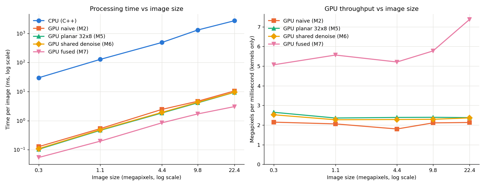
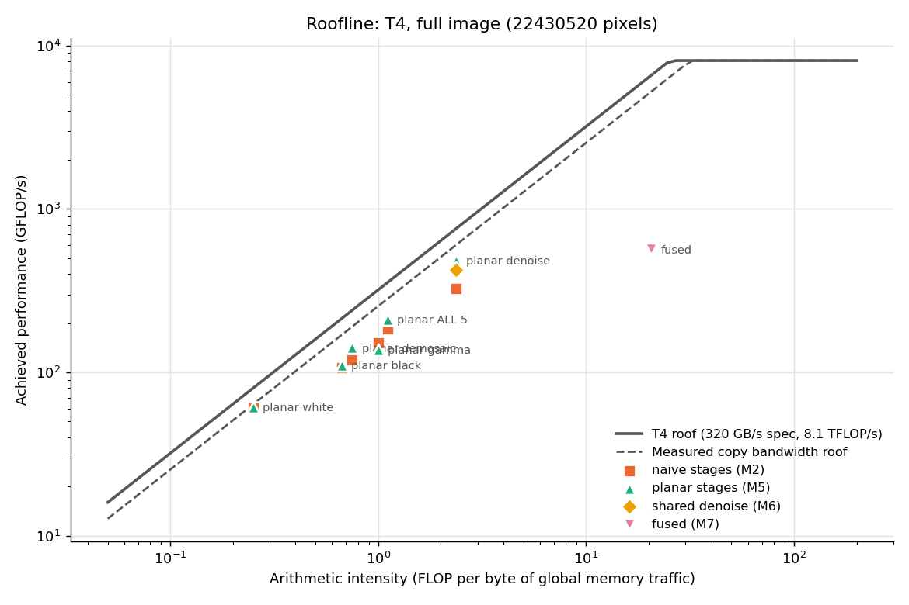

# Camera Image Signal Processing (ISP) Pipeline in CUDA

A simplified camera ISP that turns raw Bayer sensor data into a colour photo. I wrote it first in plain C++ as a reference, then in CUDA, and then optimised the GPU version step by step, measuring the effect of each change on an NVIDIA T4 (Google Colab).

| Raw Bayer data (zoomed) | After the pipeline (same crop) |
|---|---|
|  |  |

The raw image has only one colour per pixel (an RGGB Bayer mosaic), which shows up as the dot-matrix texture on the left. The pipeline fills in the missing colours and corrects the image.


## The 5 stages

1. **Black level correction:** subtract the sensor's black level and scale to 0.0–1.0 using the white level.
2. **Demosaic:** bilinear interpolation for an RGGB pattern.
3. **White balance:** multiply R, G and B by the camera's white balance gains.
4. **Denoise:** 3 × 3 Gaussian blur on each colour channel.
5. **Gamma:** power 1/2.2, then convert to 8-bit.

The pipeline is deliberately simplified: there's no colour correction matrix and no edge-aware demosaic. The focus is on correctness and GPU performance, not photo quality.

## Results

All numbers below come from my runs on a Colab **Tesla T4** (CUDA 13.0, `-arch=sm_75`), on a **5796 × 3870 (22.4 MP)** Canon EOS 5D Mark III DNG. GPU kernel times are the average of 10 warm runs, measured with CUDA events. Times vary by up to about ±25% between Colab sessions, so every comparison was measured within a single run.

### Each version, on 5 image sizes (one session)

Times in ms. GPU columns are kernel time only; copies are shown separately.

| Size | MP | CPU (C++) | GPU naive | GPU planar | GPU shared | **GPU fused** | Copy in | Copy out | Check |
|---|---|---|---|---|---|---|---|---|---|
| 640×428 | 0.27 | 29.90 | 0.128 | 0.103 | 0.109 | **0.054** | 0.157 | 0.274 | PASS |
| 1280×856 | 1.10 | 128.24 | 0.532 | 0.465 | 0.483 | **0.197** | 0.510 | 0.821 | PASS |
| 2560×1710 | 4.38 | 488.47 | 2.433 | 1.834 | 1.919 | **0.840** | 1.769 | 3.029 | PASS |
| 3840×2564 | 9.85 | 1316.69 | 4.667 | 4.113 | 4.295 | **1.706** | 3.860 | 6.868 | PASS |
| 5796×3870 | 22.43 | 2738.21 | 10.530 | 9.435 | 9.497 | **3.040** | 9.275 | 15.007 | PASS |



**How to read the speed-up honestly:**
- The CPU version is **single-threaded** C++ (`g++ -O2`).
- On the full image, the fused kernel is about **900× faster** than that CPU code, counting **kernel time only**.
- Including the copies between CPU and GPU (about 24 ms), the end-to-end speed-up is about **100×**. The copies now take far longer than the computation.

### Correctness

Every GPU version is checked value by value against the C++ reference (`compare_outputs`). On the full image, **67,291,535 of 67,291,560 values match exactly**, and the remaining 25 differ by 1/255. Those differences come from floating-point rounding (fused multiply-add on the GPU, a different `powf` implementation) landing on either side of a rounding boundary.

## What each optimisation did

| Step | Change | Result |
|---|---|---|
| Milestone 2 | Naive CUDA: one kernel per stage, one thread per pixel | ~263× faster than the CPU (kernels only) |
| Milestone 5 | **Memory coalescing:** planar R/G/B layout and 32 × 8 blocks | ~10% faster overall; denoise 27% faster. A deliberately uncoalesced layout was **4.3× slower**. |
| Milestone 6 | **Shared-memory tiling** of the denoise stage (with a 1-pixel halo) | **Slightly slower** than the plain version (see below) |
| Milestone 7 | **Kernel fusion:** all 5 stages in one kernel with shared-memory tiles | **2.5× faster** than the best 5-kernel version; GPU memory use cut from 740 MB to 112 MB |

**Why shared memory didn't help denoise:** on the T4, shared memory and the L1 cache use the same on-chip memory. The plain kernel was already getting its repeated neighbour reads from L1 automatically. The shared-memory version only added a loading phase and a `__syncthreads()` barrier. Both versions produce bit-identical results, and the slowdown showed up at every image size. The same tiling technique *was* essential for the fused kernel, where no cache can stand in for the full-size in-between images.

## Roofline analysis

I counted the bytes and floating-point operations per pixel **by hand** (minimum unavoidable memory traffic), then compared them against the T4's peaks. A simple copy kernel measured the realistic bandwidth ceiling.

| | Value | Source |
|---|---|---|
| FP32 peak | 8.1 TFLOP/s | [NVIDIA T4 datasheet](https://nvidia.com/content/dam/en-zz/Solutions/Data-Center/tesla-t4/t4-tensor-core-datasheet.pdf), [product page](https://www.nvidia.com/en-gb/data-center/tesla-t4) |
| Memory bandwidth (spec) | 300 GB/s (datasheet) / "over 320 GB/s" (product page) | same |
| **Measured copy-kernel bandwidth** | **254.2 GB/s** (79% of 320) | my run |
| Ridge point | 8100 / 320 ≈ 25.3 FLOP/byte | |

| Kernel (planar) | FLOP/byte | Achieved GB/s | % of measured bandwidth | Limited by |
|---|---|---|---|---|
| black level | 0.67 | 165.9 | 65% | memory |
| demosaic | 0.75 | 188.7 | 74% | memory |
| white balance | 0.25 | 244.5 | **96%** | memory (at the ceiling) |
| denoise | 2.38 | 204.4 | 80% | memory |
| gamma | 1.00 | 137.9 | 54% | memory + `powf` instruction cost |
| **all 5 kernels** | 1.11 | 190.9 | 75% | **memory** |
| **fused** | ~20.5 | 27.6 | 11% | **instruction overhead** |



- Every separate stage sits far left of the ridge point, so it's **memory-bound**. White balance and denoise run at 80–96% of the measured bandwidth.
- Fusion cuts the estimated traffic from **85 to 5 bytes per pixel (17×)**, moving the pipeline close to the ridge point. The fused kernel then hits neither roof. Its limit becomes work the simple model doesn't count: integer index arithmetic, `powf` (about 10 instructions, counted as 1), `__syncthreads()` waits, and the ~33% of demosaic work repeated in the tile halos.

**Next steps I'd try:** pinned host memory and CUDA streams to shrink and overlap the copies (now the largest cost), a lookup table to replace `powf`, and a multi-threaded CPU baseline for a fairer comparison.

## Repository layout

```
src/            all C++, CUDA and Python source files
notebooks/      one Colab notebook per milestone (0-9), with explanations
images/         pictures used in this README
```

| Milestone | Notebook | Main source files |
|---|---|---|
| 0 Setup, raw conversion | `milestone0_setup.ipynb` | `convert_raw.py` |
| 1 CPU reference | `milestone1_cpu.ipynb` | `cpu_main.cpp`, `cpu_*_stages.cpp`, `isp_io.*`, `view_output.py` |
| 2 Naive CUDA | `milestone2_naive_cuda.ipynb` | `gpu_naive_main.cu`, `gpu_*_kernels.cu`, `cuda_helpers.*` |
| 3 Correctness check | `milestone3_correctness.ipynb` | `compare_outputs.cpp` |
| 4 Timing with CUDA events | `milestone4_timing.ipynb` | `gpu_naive_timed_main.cu`, `gpu_buffers.*` |
| 5 Memory coalescing | `milestone5_coalescing.ipynb` | `gpu_planar_kernels.*`, `gpu_coalescing_experiment_main.cu` |
| 6 Shared memory | `milestone6_shared_memory.ipynb` | `gpu_shared_denoise.*`, `gpu_shared_experiment_main.cu` |
| 7 Kernel fusion | `milestone7_fusion.ipynb` | `gpu_fused_kernel.*`, `gpu_fusion_experiment_main.cu` |
| 8 Image-size experiment | `milestone8_sizes.ipynb` | `benchmark_sizes.py`, `cpu_benchmark_main.cpp`, `gpu_benchmark_main.cu` |
| 9 Roofline analysis | `milestone9_roofline.ipynb` | `gpu_roofline_main.cu`, `roofline_analysis.py` |

## How to run it

Everything runs on Google Colab's free T4 GPU, and no NVIDIA hardware is needed locally. The easiest way is to open the notebooks in order: each one writes its source files, compiles them and runs them.

To build by hand, run these from a folder containing `src/`'s files plus `data/` and `output/` folders:

```bash
pip install rawpy numpy pillow matplotlib
python convert_raw.py data/your_file.dng          # writes data/bayer.bin + data/metadata.txt

g++ -O2 -std=c++17 -o cpu_isp cpu_main.cpp cpu_pointwise_stages.cpp cpu_neighbourhood_stages.cpp isp_io.cpp
./cpu_isp                                          # writes output/cpu_output.bin

nvcc -O2 -arch=sm_75 -o gpu_fusion gpu_fusion_experiment_main.cu gpu_fused_kernel.cu \
     gpu_planar_kernels.cu gpu_buffers.cu gpu_pointwise_kernels.cu gpu_neighbourhood_kernels.cu \
     cuda_helpers.cu isp_io.cpp
./gpu_fusion                                       # writes output/gpu_fused_output.bin

g++ -O2 -std=c++17 -o compare_outputs compare_outputs.cpp isp_io.cpp
./compare_outputs output/cpu_output.bin output/gpu_fused_output.bin
python view_output.py output/gpu_fused_output.bin output/gpu_fused_output.png
```

**Test image:** *Adobe DNG Converter – Canon EOS 5D Mark III – 16bit Lossless JPEG compression (3:2).DNG* from [raw.pixls.us](https://raw.pixls.us). The raw files and binary outputs aren't included in this repository because they're 20–270 MB each.

## Code style

The code is written to be read by someone learning CUDA. It uses long descriptive names, one action per line, no macros, no ternary operators and no `auto`. Every CUDA-specific call is explained in a comment where it first appears, and every CUDA API call is checked with a plain `checkCudaError()` function.
